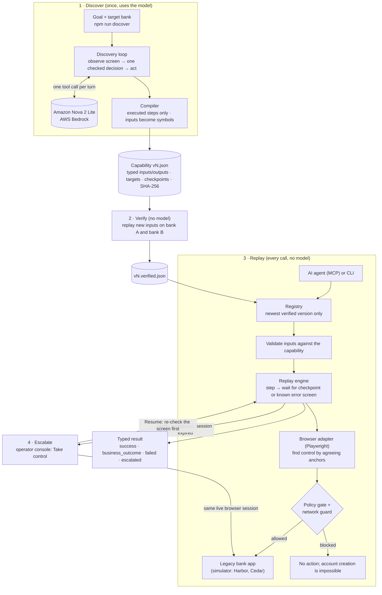

# Verified UI capabilities

Legacy banking software may have no usable API. Repeating each task with an LLM
adds cost and leaves every UI action open to a new decision.

This prototype lets a model complete a task once, saves the verified actions as a
reusable capability, then runs that capability with new inputs without a model.

**Built example:** find a member, prepare a savings application, and stop at its
review screen. Return the member ID, product, nickname, and opening deposit read
from that screen. All data is synthetic. Final account creation is blocked.

## How it works



1. **Discover.** The model sees a simplified view of the current screen and picks one
   action at a time. Every decision must reference an element on that screen, use
   input names instead of raw values, and pass the safety policy.
2. **Compile.** Only actions that actually ran become steps. Any leftover discovery
   value fails the build. The capability is a typed JSON contract with a digest.
3. **Verify.** It becomes callable only after replaying, with no model, on inputs it
   was not discovered with, on both bank variants.
4. **Replay.** Each call validates inputs, then runs the steps. Every step waits for
   its expected screen or a known error screen and returns a typed result.
5. **Escalate.** When it cannot safely continue, it pauses; a person takes over the
   same browser and hands back; the run re-checks the screen before continuing.

## Features

Core (what the brief evaluates):

- Real discovery with Amazon Nova 2 Lite on AWS Bedrock; evidence in `evidence/discovery/`.
- Typed, versioned JSON capabilities with input bindings and integrity checks.
- Model-free replay with locator agreement, checkpoints, and verified outputs.
- Separate business outcomes, bounded recovery, failures, and human escalation.
- Operator takeover and safe resume in the same live browser session.
- One capability reused across two bank variants through tenant settings.
- MCP tools that let an agent discover and call verified capabilities.
- Independent evaluation: 12 fault scenarios × 2 banks × 5 input sets, plus repeat
  runs and handoffs (132 cases).

Beyond the brief (added for a credible handoff and retry story, not part of the
capability contract): local OpenID Connect sign-in with tenant roles, and durable
run records with duplicate-request protection and crash review.

## Build and run

Node.js 24 or newer. Saved-capability replay needs no AWS credentials.

```sh
npm ci
npx playwright install chromium
npm run build
npm test
node dist/src/cli.js demo:replay --headless
```

The build writes runnable JavaScript and required assets to ignored `dist/`.
Demo and verification commands start local services on ports 4100-4104. Run those
commands sequentially. Evaluation uses temporary ports; metrics reads saved files.

| Command                                        | Demonstrates                                                    |
| ---------------------------------------------- | --------------------------------------------------------------- |
| `npm run demo:replay -- --headless`            | Verified replay on bank A                                       |
| `npm run demo:replay -- --tenant b --headless` | Same capability on bank B                                       |
| `npm run demo:failure -- --headless`           | Reject a wrong review amount                                    |
| `npm run demo:handoff`                         | Take over and resume the live session                           |
| `npm run demo:sso`                             | Sign in through local SSO, then take over and resume            |
| `npm run operator:setup`                       | Create an owner-only local operator credential                  |
| `npm run operator`                             | Review interrupted runs after a worker restart                  |
| `MCP_HEADLESS=true npm run demo:mcp`           | Actual MCP listing and invocation                               |
| `npm run eval`                                 | Full independent evaluation                                     |
| `npm run metrics`                              | Recompute measured cost, latency, and accuracy                  |
| `npm run verify`                               | Recheck both banks after runtime or profile changes             |
| `npm run test:edges`                           | DOM races, redirects, uncertain writes, and malformed contracts |

Replay accepts `--input <file>` with these synthetic inputs:

```json
{
  "memberId": "200345",
  "productCode": "SAV-HY",
  "nickname": "Summer fund",
  "openingDepositMinor": 15000
}
```

Inputs are checked against the capability's own schema before the simulator starts
or any earlier evidence is touched. A bad file fails with `INVALID_INPUTS` (naming
fields, never values), `INVALID_INPUT_JSON` (without echoing the file), or
`INPUT_FILE_NOT_FOUND`.

Use `--scenario member_not_found` to exercise a business outcome. Use `--fixture`
for the explicit handwritten test capability instead of the saved live artifact.

## Sign-in and human handoff

Run `npm run demo:sso`. It starts the simulator, identity provider, and console.
Select **Sign in with SSO** and use `operator-a` with its generated password from
the private file `.runs/sso-users.json`. Then select **Take control**.
In the existing Chromium window, enter `demo-unlock` and select **Resume session**.
Then select **Resume** in the console. The system checks the current member and
screen before continuing. Automated handoff evidence uses scripted test operators.

| Identity                   | Access                                                |
| -------------------------- | ----------------------------------------------------- |
| `operator-a`, `operator-b` | View and control runs for their own tenant            |
| `reviewer-a`               | View tenant A runs without controlling them           |
| `admin`                    | Control both tenants and acknowledge interrupted runs |
| `agent-a`, `agent-b`       | MCP invocation and status for their own tenant        |

Grants come from `config/access.json`, never from caller arguments or token roles.
Restart the worker after changing grants. Sessions expire after 15 minutes; sign-out
revokes the session and its live updates. All services bind to loopback. The local
identity provider is a protocol simulator with synthetic accounts.

For key-based sign-in, use `npm run operator:setup` and `npm run demo:handoff`.
The private `.runs/operator-key` grants local administration. `OPERATOR_TOKEN` can
replace it. SSO mode disables key sign-in. Credentials never appear in console HTML.

For separate processes, start `npm run sso` and set the OIDC values shown in
`.env.example` before starting `npm run operator` or `npm run mcp`. MCP uses the
service identity selected by `MCP_PRINCIPAL` (default `agent-a`). The MCP demo uses
`agent-b`. Stdio MCP trusts the launching OS user; it is not a remote login endpoint.

## Restart and retry behavior

MCP calls require a stable `requestKey` for each logical request. Retrying the same
key and inputs returns the existing run; different inputs with that key are rejected.
Keys are scoped to the service identity and tenant.
Run metadata and action intents are synced to `.runs/runtime/` before dispatch.
One worker owns this directory. Inputs, outputs, browser cookies, and passwords
are not saved there.

Only runs where a write may have happened unseen need review: a failure after a
dispatched draft step whose result was never verified, or a failure or abort after a
person controlled the session. Read-only failures, business outcomes, and runs
stopped while escalated with no pending write settle normally (`WORKER_STOPPED`) and
never block later runs. After a crash, unfinished runs become **interrupted**. Start `npm run operator -- --sso`,
sign in as `admin`, inspect the target application, then acknowledge the interruption. Stop
the console before starting another worker. Acknowledgment never repeats an action
or claims it succeeded. The lost browser session cannot resume; completed outputs
also remain unavailable after restart. Do not delete `.runs/runtime/` to clear a
failure: it contains the duplicate-request history. Use a local filesystem.

## New discovery: run the agent on a goal, then replay its artifact

Configure a local `.env` using `.env.example`. The target is chosen with
`--tenant` (`a` or `b`), which selects that bank's entry point and profile. Then:

```sh
npm run discover -- --headless --tenant a --goal "Find the specified member and prepare their savings sub-account application. Stop at the review screen and return the member ID, product code, nickname and opening deposit."
npm run demo:replay -- --headless
npm run demo:replay -- --tenant b --headless
```

Discovery saves the next `capabilities/open_savings_subaccount_to_review/vN.json`
and its evidence under `evidence/discovery/<run-id>/`; replay then uses the newest
verified version with no model.

Bedrock supports SigV4 credentials or a bearer token. `.env.example` sets the model
to Nova 2 Lite (`BEDROCK_MODEL`) in `us-east-1`; models must be in the priced
allowlist in `src/discovery/bedrock.ts`. Discovery is the only paid path. The cumulative $3 allowance
is tracked in `.runs/model-budget.json`; cleanup preserves it. A new artifact
becomes callable only after different-input replay passes on both banks.

## Read more

- [REPORT.md](REPORT.md): architecture, stack choices, safety, and explicit cuts.
- [docs/ARCHITECTURE.md](docs/ARCHITECTURE.md): production deployment design and its seams in this code.
- [Measured results](evidence/metrics.md) and [evaluation](evidence/eval/report.md).
- [Evidence index](evidence/README.md): where each result comes from.

Code lives in `src/`; `sim/` and `vendor/` define the target and tenant settings.
`test/`, `eval/`, and `fixtures/` validate it. `capabilities/` holds immutable artifacts.
