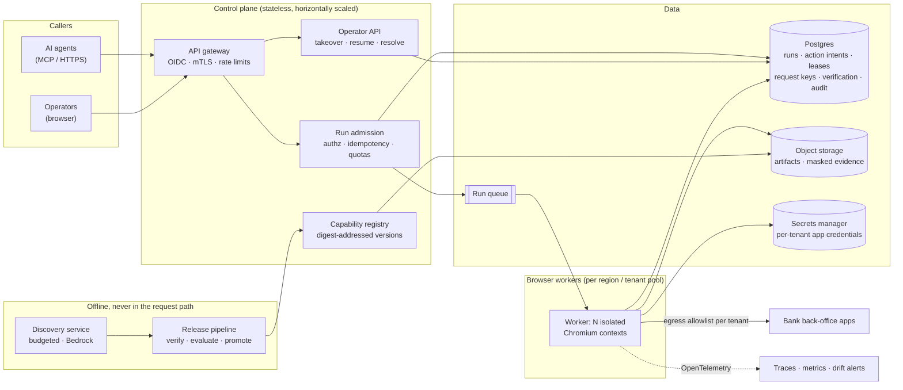

# Production architecture

This repository is one process: a CLI, an MCP server, an operator console, a replay
engine and a browser, sharing local files. That is deliberate (the brief rewards a
correct core over infrastructure). This document shows how the same components
deploy as a multi-tenant product for hundreds of institutions running about 20 apps
each, and which seam in today's code each production piece grows from. Nothing here
is built beyond what the "Today" column names.

## 1. Shape

## 2. From today's seams to production

| Concern                  | Today (file)                                                                                                                                                     | Production                                                                                                           |
| ------------------------ | ---------------------------------------------------------------------------------------------------------------------------------------------------------------- | -------------------------------------------------------------------------------------------------------------------- |
| Run unit                 | `ReplayEngine` owns one browser context and one session; nothing is shared between runs (`src/replay/engine.ts`)                                                 | A queued job leased by one worker; workers hold N contexts and scale on queue depth                                  |
| Durable state            | `RunStore` fsyncs run records and action intents before dispatch; one worker claims the directory exclusively (`src/control/run-store.ts`)                       | Postgres rows written in the same order: intent committed before the browser acts                                    |
| Duplicate requests       | `requestKey` → HMAC digest, unique per service identity and tenant                                                                                               | Unique index on (tenant, principal, key digest); retries return the existing run                                     |
| Crash recovery           | Restart marks unfinished runs `interrupted`; a human resolves as `abandon` or `confirmed_complete`; no automatic write replay                                    | Lease expiry marks the run `interrupted`; same review queue in the operator console                                  |
| Control ownership        | Session epochs: every handover increments; stale actions refused at dispatch (`src/control/session.ts`)                                                          | Lease row with a fencing token checked by the worker before each action, so a partitioned worker cannot act          |
| Artifacts                | Immutable `vN.json` with SHA-256 digest; verification bound to runtime, policy and profile digests (`src/registry.ts`)                                           | Object storage keyed by digest; promotion and rollback by digest                                                     |
| Release safety           | Changing runtime code invalidates verification until `npm run verify` passes on both tenants                                                                     | CI re-verifies and runs the evaluation suite against the simulator and a vendor sandbox before a version is callable |
| Tenants                  | Profiles change origin, frame names and labels only; steps, identity and completion cannot be overridden (`vendor/legacy-core/tenants/`)                         | Tenant config service; one capability per vendor version serves every tenant on that version                         |
| Identity and permissions | OIDC sign-in, 15-minute sessions; `AccessPolicy` grants `read`, `invoke`, `control`, `resolve` per tenant from `config/access.json`                              | Corporate SSO; grants managed in the control plane; every decision written to the audit log                          |
| Safety                   | Policy gate on every action; browser network guard blocks commit endpoints, off-allowlist origins and unsafe redirects for automation and humans (`src/policy/`) | Unchanged in code, plus network-level egress allowlists per tenant pool                                              |
| Secrets                  | Local `.env`; never in artifacts, logs or evidence                                                                                                               | Secrets manager; workers fetch per-run, short-lived credentials                                                      |
| Observability            | JSONL journals with allowlisted fields; per-call tokens and cost, per-step latency, outcome metrics (`eval/metrics.ts`)                                          | OpenTelemetry spans per step; dashboards per tenant × capability; alerts on drift and outcome mix                    |
| Discovery                | Separate CLI path with a $3 cumulative ledger; never imported by replay                                                                                          | Offline service with per-team budgets; output enters the release pipeline, never production directly                 |

## 3. Request lifecycle

1. An agent calls a capability with typed inputs and a `requestKey`. The gateway
   authenticates the service identity.
2. Admission checks `invoke` permission for the tenant, validates inputs against the
   capability's schema, and inserts the run with its key digest. A duplicate key
   returns the existing run instead of starting another.
3. The run is queued. A worker in the tenant's pool leases it and receives a fencing
   token.
4. The worker loads the artifact by digest, the tenant profile, and short-lived app
   credentials, then opens a fresh browser context behind the tenant's egress rules.
5. For each step it commits the action intent, checks the fencing token, acts,
   then waits for the declared checkpoint or a known error screen.
6. The typed result (`success`, `business_outcome`, `failed`, or `escalated`) is
   stored; the agent reads it with `run_status`.
7. An escalation appears in the operator console. A person with `control` permission
   takes the live session, fixes it, and resumes; the run re-reads the screen first.

## 4. Failure handling

| Failure                   | Behavior                                                                                                                                                                                            |
| ------------------------- | --------------------------------------------------------------------------------------------------------------------------------------------------------------------------------------------------- |
| Worker crash or host loss | Lease expires; the run becomes `interrupted`; if an intent for a draft or commit step had been written, it waits for human review and is never re-dispatched automatically                          |
| Network partition         | The stale worker's fencing token is rejected on its next action; the run is reviewed, not duplicated                                                                                                |
| Queue redelivery          | The lease and run ID make a second delivery a no-op                                                                                                                                                 |
| Bank app slow or down     | Step deadlines bound waits; repeated application errors per tenant open a circuit breaker and return a typed failure instead of hammering the app                                                   |
| UI drift at one tenant    | Locator-consensus warnings and outcome-mix shifts are aggregated per tenant × capability; above a threshold the capability is suspended for that tenant only, and an offline re-discovery is queued |
| Bad release               | Promotion is by digest; rollback re-points the tenant to the previous verified digest                                                                                                               |

## 5. Capacity planning (assumptions to measure, not results)

Hundreds of tenants × about 20 apps means thousands of app instances, but far fewer
capabilities: one per vendor version and task, shared by every tenant on that
version. Replay in the simulator takes about 0.56 s at the median; real back-office
apps will be slower and must be measured per vendor. Concurrency is bounded by
browser contexts per worker host, set from measured memory per context, and pools
scale on queue depth. Discovery cost is per capability, not per request: the
recorded run cost $0.021.

## 6. Built here versus production work

**Built and tested:** the run unit, durable intents, request-key de-duplication,
crash review, epoch-fenced control, digest-bound verification, tenant profiles,
OIDC sign-in with tenant permissions, the policy gate and network guard, and
journal-based metrics.

**Production work:** Postgres and object storage behind the existing interfaces, a
queue and worker leases with fencing tokens, container sandboxing with per-tenant
egress, a secrets manager, corporate SSO, OpenTelemetry export, the release
pipeline with a vendor sandbox, per-tenant circuit breakers, and drift dashboards with
automatic per-tenant suspension.
